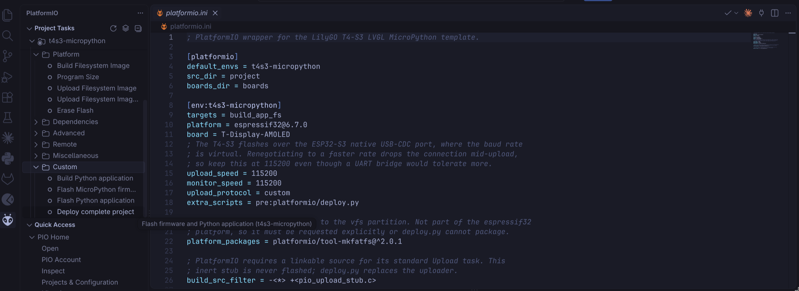

# L.I.G.M.A.B

## Application Overview

L.I.G.M.A.B is a public transport application developed for the LilyGo ESP32-T4-S3 using MicroPython and LVGL. The application helps users find public transport departures and plan journeys by bus, train and ferry in the Karlskrona area. 

## Application Features

- Display real-time public transport departuers.
- Display route numbers, destinations, arrival times and delays.
- Automatically refresh departure information every 60 seconds.
- Filter and search for stops.
- Plan journeys between two selected stops.
- Sort journey suggestions by earliest arrival time.
- Switch between dark and light mode.
- Save and restore user settings.
- Access Trafiklab's Terms of Service through QR code.

## Screen Descriptions

0. L.I.G.M.A.B screen:

Displays the application name, qroup number, group members and application version.

1. Settings screen:

Allows the user to select a transport type and a stop. 

The user can switch between dark and light mode, save their current settings or restore previously saved settings. 

Trafiklab's Terms of Service can be accessed by selecting "Trafiklab ToS" and scanning the displayed QR code.

2. Departurure screen:

Displays upcoming departures from the selected stop, including: 

- Route number
- Transport type
- Destination
- Estimated time of arrival(ETA)
- Delays

Departure information is automatically refreshed every 60 seconds while the screen is active.

-1. Journey Selection Screen:

Allows the user to select a departure stop (From) and a destination stop (To).

Stops can be selected using dropdown menus or searched for using the on-screen keyboard.

-2. Top 5 Journeys:

Displays journey suggestions between the selected departure and destination stops.

Each journey contains departure and arrival times, total travel duration and individual travel segments, including transfers and walking distances where applicable.

Journeys are sorted by earliest arrival time.

## Navigation

The user navigates between the main screens by swiping horizontally on the touchscreen.

The QR code screen is accessed through the Settings Screen.

## Trafiklab API Integration

The application uses two APIs to retrieve public transport information:

- Trafiklab Realtime API: Provides departure information, destinations, scheduled and real-time departure times, delays and cancellations.

- ResRobot API: Provides journey suggestions between selcted stops, including travel times, transfers and walking segments.

The application uses STOPS.json to associate stop names with their corresponding stop IDs.

## Project structure

# File                 # Description
project/main.py        Handles the user interface, navigation, settings and Wi-Fi connection.
project/data.py        Retrieces, processes and sorts public transport data.
project/STOPS.json     Contains stop names and their corresponding IDs.
project/secrets.py     Contains Wi-Fi credentials and API keys.
t4s3-simulator/        Contains the desktop simulator.

## API Configuration 

To retrieve live public transport information, valid API keys must be added to project/secrets.py:

TRAFIKLAB_API_KEY = "YOUR API KEY"
RESROBOT_API_KEY = "YOUR_API_KEY"

Never commit real API keys or Wi-Fi credentials to GitHub.


# ESP32-T4-S3-MicroPython-Template

Welcome to the lab using the ESP32-T4-S3 LilyGO!

This repository serves as a foundation for software engineering projects aimed at the ESP32 hardware.
This document will guide you through the setup process and help you prepare to work with your ESP32 hardware.

The supplied firmware already contains MicroPython and LVGL. You write Python;
you do not compile MicroPython, LVGL, or a GUI library.

---

# How to get started

The student workflow works on Windows, Linux, and macOS. The first PlatformIO
setup can take several minutes while tools are installed.

## PlatformIO

1. Install Visual Studio Code
   * Visit [Visual Studio Code's website](https://code.visualstudio.com/download) and download the latest version or use the package manager of your system.
   * Run `Visual Studio Code` and follow the steps.
2. Install the correct extension.
   * Head over to the extensions tab on your left.
   * Search for ["PlatformIO IDE"](https://marketplace.visualstudio.com/items?itemName=platformio.platformio-ide) and install it.


## Linux: serial port access

Windows and macOS need no extra setup. On Linux the board's serial port is
owned by a system group, so PlatformIO cannot open it until you grant access.
Install the PlatformIO udev rules once:

```bash
curl -fsSL https://raw.githubusercontent.com/platformio/platformio-core/develop/platformio/assets/system/99-platformio-udev.rules \
  | sudo tee /etc/udev/rules.d/99-platformio-udev.rules
sudo udevadm control --reload-rules
sudo udevadm trigger
```

Then unplug and reconnect the board. If the port is still unreadable, add
yourself to the group that owns it (`ls -l /dev/ttyACM0` shows which):
`dialout` on Debian/Ubuntu, `uucp` on Arch.

```bash
sudo usermod -aG dialout $USER   # or uucp
```

Log out and back in for the group change to take effect.

## How to run the program

To run without a board on macOS, Windows, or Linux, see the
[desktop simulator setup](t4s3-simulator/README.md).

1. Open the locally cloned repository with Visual Studio Code
    * If the "Do you trust the authors of the files in this folder?" dialog appears, click on "Yes, I trust the authors"
2. Open up the file `project/main.py`
3. Connect your ESP32 to your computer via a USB cable.
4. Open the PlatformIO tab in the left sidebar, expand
   **Project Tasks > t4s3-micropython > Custom**, and run **Deploy complete
   project**. This flashes the MicroPython firmware and your Python files in
   one step, and is what the Upload button runs too.

Once the board has firmware on it, **Flash Python application** is faster for
everyday work: it writes only your `project/` files and leaves the firmware
alone.



---

# What to add where

Device application code and assets belong in the [**/project**](project/main.py)
folder, which is copied recursively into the device filesystem image.
Desktop application tests belong in the top-level `tests/` folder so they
are not packaged or deployed. Selected board support files are added from
`support/` separately.

## How to connect to Wi-Fi

The T4-S3 has built-in Wi-Fi, but it cannot connect to eduroam. Use another
network or a phone hotspot.

Add or modify the `project/secrets.py` file, then set the SSID
(network name) and password.

```python
WIFI_SSID      = "SSID"
WIFI_PASSWORD  = "PWD"
```

Never commit real credentials to GitHub. `project/secrets.py` is excluded by
the supplied `.gitignore`.

---

# Troubleshooting

## The screen still shows the old interface, and touch does nothing

The board is probably still in upload mode. Tap **RESET/RST once**. 
A retained image on the AMOLED does not mean the application is running.

## Upload cannot connect

1. Stop PlatformIO Monitor with `Ctrl+C`.
2. Disconnect and reconnect the USB cable if the port is locked.
3. Repeat the BOOT/RESET upload-mode sequence.
4. Start Upload again.

On Linux, `Permission denied` on `/dev/ttyACM0` means the udev rules above are
not installed.

## Upload stops at "Stub running... No serial data received"

The board flashes over the ESP32-S3's built-in USB port, where the baud rate is
virtual and cannot be renegotiated. Check that `upload_speed` in
`platformio.ini` is still `115200`; raising it produces exactly this error.

After a failed upload the board may not restart on its own. Press **RESET**
by hand before retrying.

## Upload fails with "Invalid head of packet"

This appears once a Python application is already running on the board: it
prints to the same USB port the uploader needs, and the automatic reset into
upload mode cannot interrupt it. Enter upload mode by hand instead.

1. Hold **BOOT**.
2. Tap **RESET**.
3. Release **BOOT**.
4. Start the upload task immediately.

The board stays in upload mode afterwards, so press **RESET** once when the
upload finishes to start your application.

Close PlatformIO Monitor first if it is running; anything else holding the
serial port causes the same error.

## The screen is black

Open PlatformIO Monitor after resetting. Startup errors are printed at 115200
baud and also stored as `/debug.log` on the device.


## LilyGo tutorial

Visit LilyGO [link](https://github.com/Xinyuan-LilyGO/LilyGo-AMOLED-Series)


